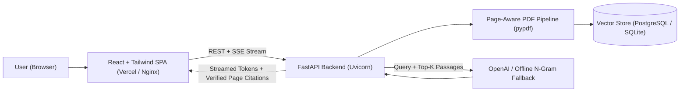

# DocuMind — Grounded PDF Q&A with Page-Level Citations

DocuMind is a production-ready, full-stack document question-answering system. Users upload a text-based PDF, track processing progression (`Uploading → Processing → Ready`), ask questions in natural language, and receive streamed answers strictly grounded in retrieved passages with verified, clickable page citations that open the source page directly in the viewer.

---

## Architecture



---

## Deploy to Vercel ("Word Cell")

DocuMind is pre-configured for seamless deployment to [Vercel](https://vercel.com):

### Option A: Automatic Root Deployment (Recommended)
1. Push your repository to GitHub (see [GitHub Instructions](#push-to-github) below).
2. Go to [vercel.com/new](https://vercel.com/new) and import your `documind` repository.
3. Keep default settings (the included `vercel.json` and root `package.json` will automatically build the `frontend/` directory).
4. *(Optional)* Add the Environment Variable `VITE_API_BASE_URL` pointing to your deployed FastAPI backend (e.g., on Render, Railway, or VPS). If left blank, DocuMind runs with its built-in interactive preview and in-browser fallback.
5. Click **Deploy**.

### Option B: Deploy `frontend/` Directly
1. In Vercel Project Settings, set **Root Directory** to `frontend`.
2. Framework Preset: **Vite**.
3. Output Directory: `dist`.
4. Click **Deploy**.

---

## Push to GitHub

To publish this project to your GitHub account:

```bash
# 1. Initialize Git repository
git init
git branch -M main

# 2. Stage all organized files
git add .

# 3. Create initial commit
git commit -m "feat: complete DocuMind full-stack architecture with page citations and Vercel support"

# 4. Link your remote GitHub repository
git remote add origin https://github.com/<your-username>/<your-repo-name>.git

# 5. Push to GitHub
git push -u origin main
```

*(All sensitive files like `.env`, local SQLite `.db`, virtual environments, and `node_modules` are safely excluded by `.gitignore`.)*

---

## Quick Start: Self-Hosting with Docker Compose

To run the entire full-stack system (PostgreSQL with pgvector, FastAPI, Nginx, and React SPA):

1. **Configure environment variables**:
   ```bash
   cp .env.example .env
   # Add your OPENAI_API_KEY in .env (optional; local deterministic fallback runs offline)
   ```

2. **Launch the stack**:
   ```bash
   docker compose up --build -d
   ```

3. **Access the application**:
   - Web Application: [http://localhost:8080](http://localhost:8080)
   - FastAPI OpenAPI Documentation: [http://localhost:8000/docs](http://localhost:8000/docs)

---

## Local Development (Without Docker)

### 1. FastAPI Backend
```bash
cd backend
python -m venv .venv
# On Windows:
.venv\Scripts\activate
# On Linux/macOS:
source .venv/bin/activate

pip install -r requirements.txt
uvicorn app.main:app --reload --port 8000
```

### 2. React + Vite Frontend
```bash
cd frontend
npm install
npm run dev
```
Open [http://localhost:5173](http://localhost:5173). Vite automatically proxies `/api/*` and SSE streams to `http://localhost:8000`.

---

## Project Structure

```text
├── backend/
│   ├── app/
│   │   ├── __init__.py          # FastAPI package definition
│   │   ├── database.py          # SQLAlchemy SQLite & PostgreSQL engine
│   │   ├── main.py              # REST API & SSE endpoints (title: "DocuMind API")
│   │   ├── models.py            # Document, Chunk, Conversation, Message models
│   │   ├── pdf_pipeline.py      # %PDF- validation, pypdf extraction, sentence chunking
│   │   ├── rag_service.py       # RAG generation, verified citation resolution, SSE streamer
│   │   └── vector_store.py      # text-embedding-3-small + deterministic fallback
│   ├── storage/
│   │   └── documents/           # Uploaded PDF file storage (.gitkeep)
│   ├── Dockerfile               # Production Python 3.11 container
│   ├── requirements.txt         # FastAPI, pypdf, sqlalchemy, etc.
│   └── schema.sql               # PostgreSQL / SQLite DDL schema
│
├── frontend/
│   ├── src/
│   │   ├── api/
│   │   │   └── client.ts        # Unified API client & interactive browser fallback
│   │   ├── components/
│   │   │   ├── ChatMessage.tsx          # Grounded message display
│   │   │   ├── CitationLink.tsx         # Page badge with expandable quotes
│   │   │   ├── ConversationHistory.tsx   # Per-document chat thread manager
│   │   │   ├── DocumentStatus.tsx       # Live status badge (Uploading->Processing->Ready)
│   │   │   ├── DocumentUploader.tsx     # Drag-and-drop PDF uploader with progress
│   │   │   ├── ErrorState.tsx           # Accessible error banners with retry
│   │   │   ├── MessageInput.tsx         # Autosizing question input
│   │   │   ├── PdfPageViewer.tsx        # Side-by-side #page=N citation navigator
│   │   │   └── StreamingIndicator.tsx   # Real-time token streaming indicator
│   │   ├── types/
│   │   │   └── documind.ts      # TypeScript interfaces
│   │   ├── App.tsx              # Three-panel responsive layout
│   │   ├── main.tsx             # React 18 root mounting
│   │   └── index.css            # Tailwind directives
│   ├── Dockerfile               # Multi-stage Vite builder + Nginx
│   ├── nginx.conf               # SSE streaming reverse proxy & SPA router
│   ├── package.json             # React, Tailwind, Vite dependencies
│   ├── postcss.config.js        # PostCSS configuration
│   ├── tailwind.config.js       # Tailwind CSS configuration
│   ├── tsconfig.json            # TypeScript configuration
│   ├── vercel.json              # Vercel SPA routing
│   └── vite.config.ts           # Vite dev proxy configuration
│
├── .github/
│   └── workflows/
│       └── ci.yml               # GitHub Actions CI for backend imports & frontend build
├── .env.example                 # Environment variables template
├── docker-compose.yml           # Self-hosting Docker stack
├── documind_backend.py          # Consolidated backend artifact
├── documindfrontend.tsx         # Consolidated frontend artifact
├── setup_repo.py                # Automated repository unpacker & bootstrapper
├── package.json                 # Monorepo Vercel build helper
└── vercel.json                  # Root Vercel deployment configuration
```

---

## REST & SSE API Surface

| Method & Route | Purpose |
| :--- | :--- |
| `POST /api/documents` | Upload PDF (`%PDF-` validation, 25MB limit), initiate background chunking |
| `GET /api/documents` | List uploaded documents with status and chunk counts |
| `GET /api/documents/:id` | Retrieve status, page count, and metadata for a document |
| `GET /api/documents/:id/file` | Stream PDF binary for iframe viewing (`#page=N`) |
| `DELETE /api/documents/:id` | Cascade delete document, physical file, chunks, and conversations |
| `POST /api/documents/:id/conversations` | Create a new chat session for a ready document |
| `GET /api/documents/:id/conversations` | List conversation threads for a document |
| `GET /api/conversations/:id/messages` | Load chat message history with verified JSON citations |
| `POST /api/conversations/:id/messages` | Stream grounded answer via SSE (`token`, `citations`, `done`) |
