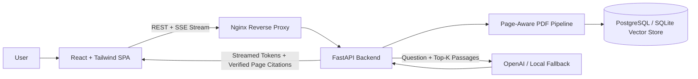

# DocuMind — Grounded PDF Q&A with Page-Level Citations

DocuMind is a full-stack document question-answering web application. Users upload a text-based PDF, watch real-time processing progress (`Uploading → Processing → Ready`), ask questions in plain language, and receive streamed answers grounded strictly in retrieved document passages with verified, clickable page citations that open the exact page in the PDF viewer.

---

## Architecture



---

## Quick Start: Self-Hosting with Docker Compose

1. **Unpack the repository layout** (if starting from the single-file artifacts):
   ```bash
   python3 setup_repo.py
   ```

2. **Configure environment variables**:
   ```bash
   cp .env.example .env
   # Optional: Add your OPENAI_API_KEY in .env
   ```

3. **Build and launch the stack**:
   ```bash
   docker compose up --build -d
   ```

4. **Open DocuMind**:
   - Web App: [http://localhost:8080](http://localhost:8080)
   - FastAPI OpenAPI Docs: [http://localhost:8000/docs](http://localhost:8000/docs)

---

## Local Development (Without Docker)

### 1. Start the FastAPI Backend
```bash
cd backend
python3 -m venv .venv
source .venv/bin/activate
pip install -r requirements.txt
uvicorn app.main:app --reload --port 8000
```

### 2. Start the React + Vite Frontend
```bash
cd frontend
npm install
npm run dev
```
Open [http://localhost:5173](http://localhost:5173). Vite automatically proxies `/api/*` requests and SSE streams to `http://localhost:8000`.

---

## Publishing to GitHub

Run these commands from your project root to push your repository to GitHub:

```bash
# 1. Ensure multi-file folders are generated
python3 setup_repo.py

# 2. Initialize Git and commit all files
git init
git add .
git commit -m "feat: initial full-stack DocuMind MVP with page citations and Docker self-hosting"

# 3. Connect your GitHub repository and push
git branch -M main
git remote add origin https://github.com/<your-username>/documind.git
git push -u origin main
```

---

## REST & SSE API Surface

| Method & Endpoint | Purpose |
| :--- | :--- |
| `POST /api/documents` | Validate and upload a PDF, then start background extraction & embedding |
| `GET /api/documents` | List uploaded documents and processing status |
| `GET /api/documents/:id` | Get status, page count, and chunk count for a document |
| `GET /api/documents/:id/file` | Serve the PDF file for `#page=N` citation navigation |
| `DELETE /api/documents/:id` | Delete document file, metadata, conversations, and chunks |
| `POST /api/documents/:id/conversations` | Create a new conversation thread for a ready document |
| `GET /api/documents/:id/conversations` | List conversation history for a document |
| `GET /api/conversations/:id/messages` | Load message history and verified citations |
| `POST /api/conversations/:id/messages` | Stream grounded answer (`event: token`, `event: citations`, `event: done`) |